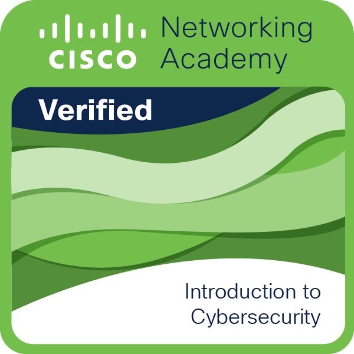

# Olá! Eu sou o Bruno 👋

---

### 🙋 Sobre mim

Estudante de **Análise e Desenvolvimento de Sistemas** na **FAETERJ-Rio**, com foco em desenvolvimento **full stack**: back-end com **Java e Spring Boot** e front-end com **React e Next.js**.

Tenho projetos em produção que vão da API ao front-end, com autenticação JWT, testes automatizados, integração contínua e integração com modelos de IA (LLMs).

- 🎓 ADS na **FAETERJ-Rio** e Técnico em Desenvolvimento de Sistemas na **Unicesumar**
- 🔭 Buscando **estágio em Desenvolvimento Full Stack ou Back-end Java**
- 🌱 Estudando agora: **IA generativa** e **cibersegurança**
- 🌎 Rio de Janeiro, Brasil · Inglês avançado
- 🌐 Portfólio: [brunoportfolio.pages.dev](https://brunoportfolio.pages.dev)

---

### 🚀 Projetos em destaque

#### 🍔 Braga's Burger · Plataforma de delivery
`Java 21` `Spring Boot 4` `PostgreSQL 16` `Next.js` `React`

- API REST com fluxo de pedidos baseado em **máquina de estados** (5 status, com validação das transições na camada de domínio)
- Segurança com **JWT em cookie httpOnly**, **rate limiting** e **log de auditoria**
- Banco versionado com **Flyway** e testes de integração com **JUnit e Testcontainers**
- Painel administrativo com alerta sonoro de pedidos e front-end entregue como **PWA instalável**
- Em produção com custo zero (Vercel, Render e Neon)

🔗 [Ver online](https://braga-s-burger.vercel.app)

#### 🥗 PratoScan · Contador de calorias com IA
`Next.js` `TypeScript` `Prisma` `PostgreSQL`

- PWA que estima as calorias a partir da **foto do prato**, usando IA com visão computacional
- Integração com **LLM** usando saída estruturada **validada por schema**
- Autenticação com **NextAuth**, **CI com GitHub Actions** e deploy na **Vercel**

📂 Veja todos os meus projetos no [portfólio](https://brunoportfolio.pages.dev/projetos)

---

### 🛠️ Tecnologias & Ferramentas

#### Back-end

#### Front-end

#### Banco de Dados

#### Testes, CI & Deploy

---

### 🏅 Certificações & Cursos

  

- 🔐 **Cisco Networking Academy** · Introduction to Cybersecurity (2026)
- ☕ **JavaNauta** · Java com Spring, Arquitetura Hexagonal, Bancos de Dados, Metodologias Ágeis, Angular e HTML/CSS/JavaScript
- 🏦 **Bootcamp Itaú** · Java e Spring *(em andamento)*
- 🤖 **Bootcamp Bradesco (DIO)** · GenAI, Dados & Cyber *(em andamento)*

---

### 📊 Estatísticas do GitHub

  
  

  

---

### 🤝 Conecte-se comigo

